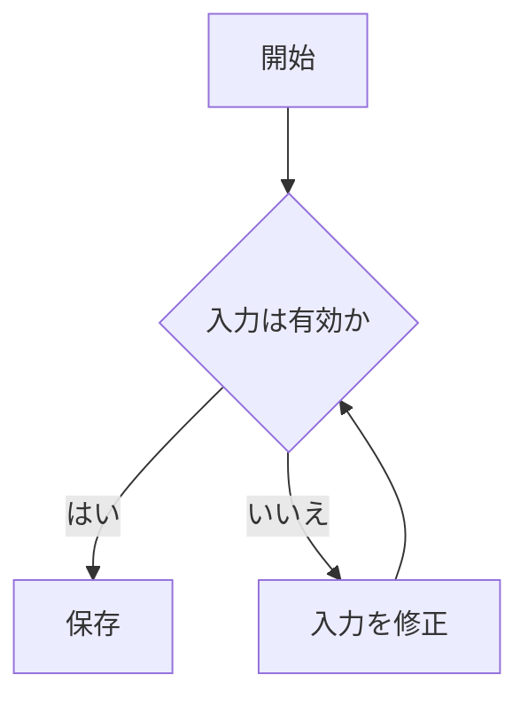

# Mermaid図

Mermaidを使って、文章だけでは伝わりにくい流れ、構造、関係をMarkdown内で表現します。対象プラットフォームでの描画対応とMermaidのバージョンを確認し、既存の図や書式規約があれば合わせます。

## 作成手順

1. 図を読む人と、その図で答える問いを決める。
2. 問いに合う図種を選び、必要な事実と関係だけを集める。
3. 読みやすい規模の図を作り、実際の情報源と照合する。
4. 対象プラットフォームで描画を確認し、必要なら構文とレイアウトを直す。

図にする価値が小さい場合は、短い文章や表を使います。ソースコードや仕様にない要素・接続・順序を図へ追加せず、推測を含む場合は推測だと明示します。

## 図種を選ぶ

| 表したい内容 | 図種・宣言 | 詳細ガイド |
| --- | --- | --- |
| 判断を含む処理や手順 | Flowchart: `flowchart TD` | [flowcharts.md](./mermaid/flowcharts.md) |
| 時間に沿った相互作用 | Sequence: `sequenceDiagram` | [sequence-diagrams.md](./mermaid/sequence-diagrams.md) |
| データベースのエンティティと関係 | ER: `erDiagram` | [erd-diagrams.md](./mermaid/erd-diagrams.md) |
| クラスと型の関係 | Class: `classDiagram` | [class-diagrams.md](./mermaid/class-diagrams.md) |
| 状態と遷移 | State: `stateDiagram-v2` | [state-diagrams.md](./mermaid/state-diagrams.md) |
| システムを階層的に表す | C4: `C4Context`、`C4Container`、`C4Component` | [c4-diagrams.md](./mermaid/c4-diagrams.md) |
| クラウド・インフラの要素と接続 | Architecture: `architecture-beta` | [architecture-diagrams.md](./mermaid/architecture-diagrams.md) |
| 日程・期間、ブランチとコミット | Gantt: `gantt`、Git graph: `gitGraph` | [その他の図種](./mermaid/README.md) |

迷った場合は、処理の流れにはFlowchart、参加者間の通信にはSequenceを使います。C4やArchitectureなど、特定バージョンで導入された図種は対象レンダラーの対応を先に確認します。

## Markdownへの埋め込み

図は `mermaid` 言語タグ付きのコードフェンスに置き、図種を示す宣言から始めます。

## 共通の作成・確認原則

- ノードIDは一意で安定した識別子にし、接続では表示ラベルでなくIDを使う。
- 図の各ノードや接続が、確認済みの情報と一致することを確かめる。
- 一つの図では一つの問いに答える。情報が多くなったら、関心ごとや詳細度ごとに分ける。
- 向き（`TD`、`LR` など）を内容と表示幅に合わせ、密集した線を避ける。
- 色や形は意味がある場合に使い、色だけで区別しない。可読性のために本文でも図の要点を説明する。
- 支援技術向けの説明が必要な場合は、対象図種が対応していることを確認して `accTitle` と `accDescr` を付ける。
- 構文・配置の細部は [構文エラー対策](./mermaid/syntax-rules.md)、テーマやアクセシビリティは[発展機能](./mermaid/advanced-features.md)を参照する。
- 対象プラットフォームが対応する構文・バージョンは、[Mermaid公式ドキュメント](https://mermaid.js.org/intro/syntax-reference.html)と実際の描画で確認する。

## 詳細リファレンス

図種別の構文は [参照資料Index](./mermaid/README.md) から必要なものだけを読みます。外部資料は調査の出典であり、実行時に読み込む依存ではありません。
