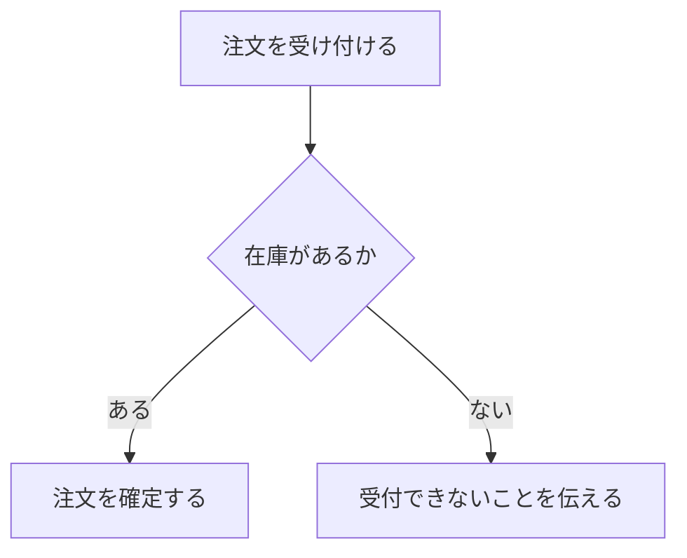
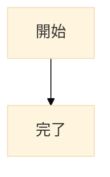

# Mermaidの発展機能

図種の基本構文ができたあとで、必要に応じてアクセシビリティ、テーマ、配置、スタイルを加えます。機能や設定はホストとMermaidのバージョンによって差があるため、対象環境で確認してください。

## アクセシビリティ

対応する図種では `accTitle` と `accDescr` を使い、図のタイトルと説明を加えられます。

タイトルと説明は、図の目的と要点を簡潔に伝えるものにします。これだけに頼らず、必要な内容は本文にも文章で説明します。対応状況や複数行説明の構文は[公式アクセシビリティ資料](https://mermaid.js.org/config/accessibility.html)で確認します。

## テーマと設定

図の先頭にfrontmatterが使える場合、図単位の設定を指定できます。プロジェクトで統一のテーマや設定が定められている場合はそれに従います。

設定できるテーマ、色、配置エンジン、見た目はホストのバージョンで異なります。例にある設定を未対応環境へそのまま持ち込まないでください。

## スタイル

- 色や形は状態・分類など意味を補う場合だけ使う。
- 色だけで成功、失敗、必須などを区別せず、ラベルや線種も併用する。
- 色のコントラストを保ち、装飾で主要な関係を見えにくくしない。
- 複数の図がある文書では、同じ意味のスタイルを一貫して使う。

## 描画と出力

まずMarkdownを表示する対象プラットフォームで確認します。レンダリングが必要なら、プロジェクトで採用済みのツールや標準手順を使い、出力形式・サイズ・フォントが読者に合うことを確認します。図の作成だけを目的に、依頼されていない依存関係や画像生成工程を追加しません。

## 出力前の確認

- 設定や装飾が対象環境で使える。
- 配色が意味を持ち、色以外の手掛かりもある。
- タイトル、説明、本文の補足が図の内容と一致する。
- 最終成果物を、実際に配布・表示する形式で確認した。
