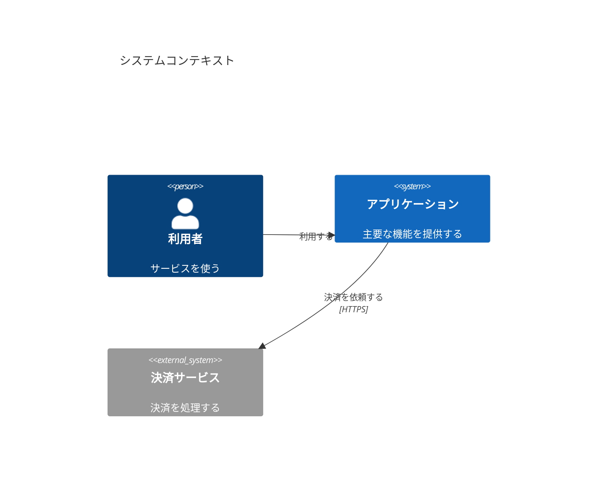

# C4図

C4図は、ソフトウェアシステムを異なる詳細度で示します。対象プラットフォームがMermaidのC4記法をサポートすることを確認してから使います。

## 詳細度

| 宣言 | 表す範囲 | 主な読者 |
| --- | --- | --- |
| `C4Context` | システム、利用者、外部システム | システムを俯瞰したい読者 |
| `C4Container` | アプリケーション、サービス、データストア | 開発者、アーキテクト |
| `C4Component` | コンテナ内部の主要コンポーネント | 開発者 |

C4の「Container」は必ずしもDockerコンテナを意味しません。C4のモデルと、実装環境のコンテナ技術を混同しないでください。コード要素の詳細は通常のClass図などを検討します。

## Contextの基本例

C4記法には `Person`、`System`、`Container`、`Component` などの要素と、`Rel` などの接続があります。外部要素やデータストアの詳細構文は、必要な範囲だけ[公式C4資料](https://mermaid.js.org/syntax/c4.html)で確認します。

## 作成時の注意

- Contextから始め、必要な問いに応じてContainer、Componentへ詳細化する。
- 図ごとに対象システムと境界を明確にする。
- 要素名と関係の説明を、関連図間で一貫させる。
- すべての可能な接続を描かず、読者の問いに必要な関係に絞る。
- 利用中のMermaidホストが対応していない場合は、Flowchartなど利用可能な図種を使い、C4表記であると誤認させない。
