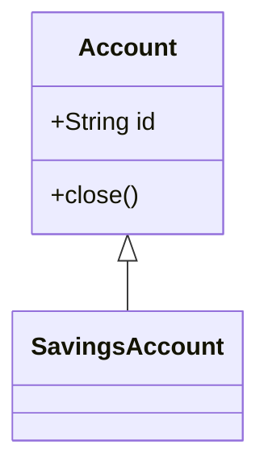

# Class diagram

Class diagramは、クラスや型、そのメンバーと関係を示します。ソースコード、型定義、または明示された設計を根拠にします。

## 基本構文

クラス名と属性・操作を必要な範囲で記載します。可視性の `+`、`-`、`#` は公開、非公開、保護を表す記号として使われます。言語固有の型やシグネチャを載せる場合は、対象の実装と表記を照合します。

## 関係

| 記号 | 関係 |
| --- | --- |
| `--` | 関連 |
| `<|--` | 継承 |
| `*--` | コンポジション |
| `o--` | 集約 |
| `<..` | 依存 |
| `<|..` | 実装・実現 |

多重度や関係ラベルは必要なときに加えます。関係記号は図の設計上の意味を持つため、レイアウト都合で選びません。

## 出力前の確認

- クラス、属性、操作が対象コードまたは合意済み設計に存在する。
- 継承、実装、集約、依存を正しく区別している。
- 詳細を載せすぎず、読者が知りたい関係に焦点を当てている。
- Mermaidの構文と対象レンダラーで描画を確認した。
