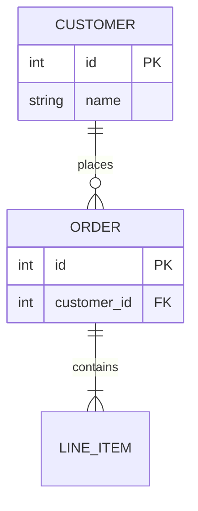

# Entity relationship diagram

ER図は、エンティティ、属性、エンティティ間の関係を示します。データベースのスキーマ説明に使い、実際のスキーマや制約を根拠に記載します。

## 基本構文

- エンティティ名は図内で一貫させます。
- 属性は `型 名前 制約` の形で示します。制約の例は `PK`（主キー）、`FK`（外部キー）、`UK`（一意キー）です。
- 多重度の記号は接続の両端に置きます。よく使う端点は `||`（一つ）、`o|`（ゼロまたは一つ）、`|{`（一つ以上）、`o{`（ゼロ以上）です。左右の位置と組合せを公式資料で確認します。
- `--` と `..` は異なる種類の関係線として描画されます。図の読み手が意味を判断できるように、必要なら凡例を付けます。

## 範囲と正確さ

データベースの全項目を図へ詰め込まず、図の問いに必要なエンティティと属性を選びます。データ型、必須・任意、多重度、リレーション名は、スキーマや仕様と照合します。Mermaid上で描画できることは、データモデルの正しさを保証しません。

## 出力前の確認

- エンティティ名、属性、キー情報がスキーマに一致する。
- 多重度と任意性が実際の制約と一致する。
- 関係の向きとラベルが一貫している。
- 対象レンダラーの構文で描画できる。
