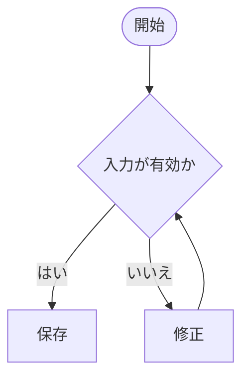
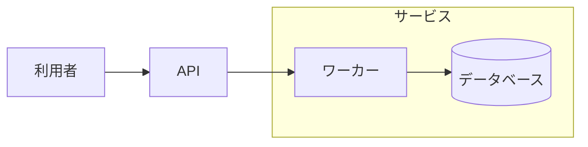

# Flowchart

Flowchartは、処理の順序、判断、分岐、繰り返しを表します。縦長の手順には `TD`、横に広がる処理には `LR` を使うなど、読む順序と表示幅に合わせて向きを決めます。

## 基本構文

- ノードはIDと形状付きラベルで定義します。IDは接続に使い、読み手向けの表示名はラベルに置きます。
- 判断点には条件を明示し、枝のラベルがどの条件に対応するか分かるようにします。
- 接続は `-->`、破線の接続は `-.->`、太い接続は `==>` などを使います。線種に意味を持たせる場合は凡例を添えます。

## ノードの形

よく使う形状は、処理の長方形 `[処理]`、開始・終了の丸角 `([開始])`、判断のひし形 `{条件?}`、データベースの円柱 `[(DB)]` です。形状の意味が読み手に分かることを優先し、装飾だけのために種類を増やしません。

## ラベルと接続

接続のラベルは `A -->|成功| B` のように線の間へ置きます。特殊文字や区切り文字を含むラベルは引用し、構文の詳細は[構文エラー対策](./syntax-rules.md)で確認します。

複数のノードを鎖状につなぐ場合は `A --> B --> C` と書けます。判断の枝を見失うほど接続を一行に詰め込まず、分岐が増えたら行を分けます。

## サブグラフ

サブグラフは関連する処理や境界をまとめる場合に使います。グループにIDを付けると、外部の接続から参照できます。

グループ内外の接続で配置方向が変わる場合があります。サブグラフを増やすより、図を分けた方が読みやすいか確認します。

## 出力前の確認

- 開始点、判断条件、例外経路、終了点が必要な範囲で示されている。
- 接続の向きが実際の順序や依存関係と一致している。
- ノードIDと表示ラベルを混同していない。
- ラベル、サブグラフ、矢印が対象レンダラーで正しく描画される。
