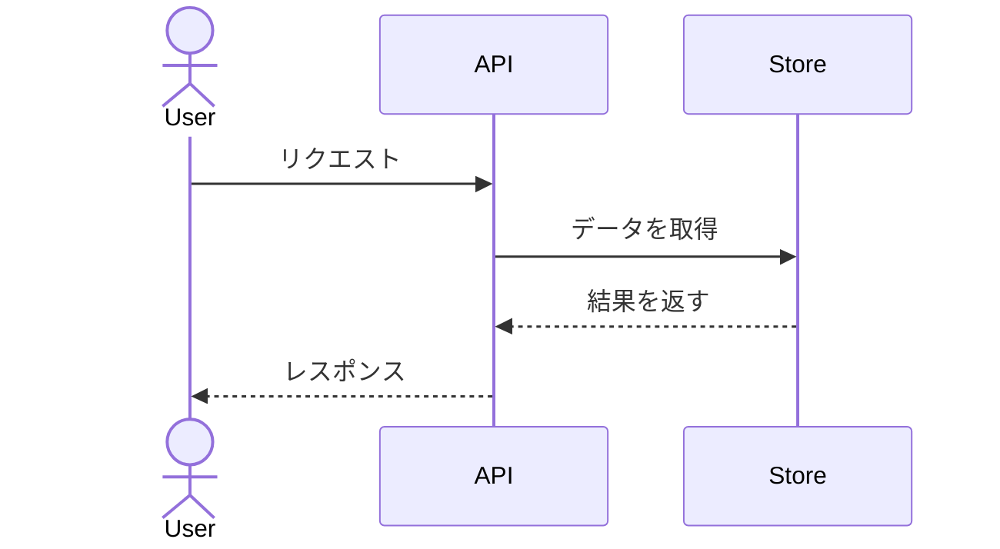
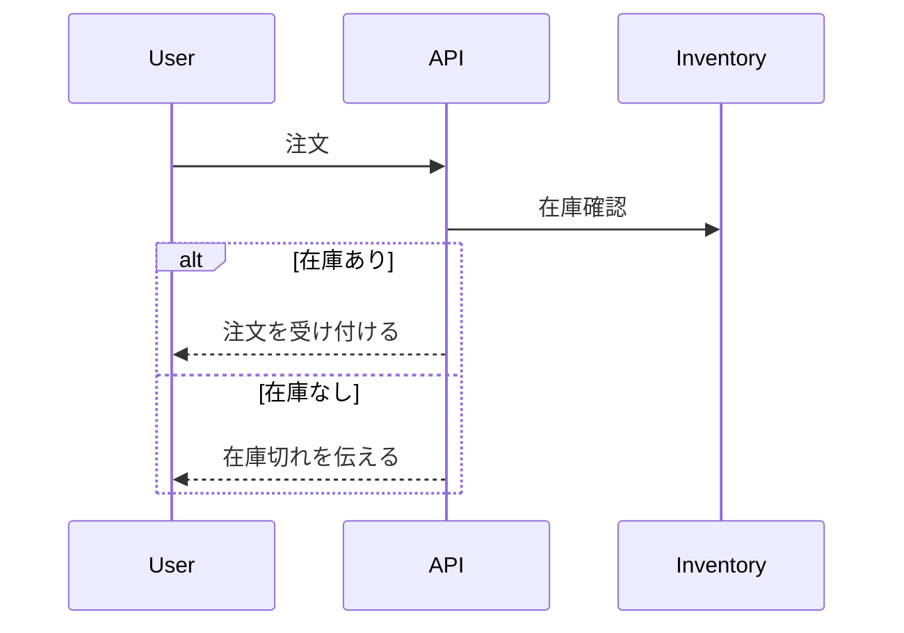

# Sequence diagram

Sequence diagramは、参加者間のメッセージと時間順を表します。APIやサービス間の相互作用、処理の要求・応答を説明するときに使います。

## 基本構文

- `actor` は人や外部システム、`participant` はサービスや構成要素に使います。
- 参加者は図の上部に宣言し、メッセージの前後関係を上から下へ並べます。
- `->>` は実線の矢印、`-->>` は破線の矢印として描画されます。矢印の意味をチームで定めている場合は既存の凡例に従います。
- `-)` や `--)` の非同期矢印は、非同期送信が実際にある場合に限って使います。

## 条件、並列、反復

`alt` と `else` は条件分岐、`opt` は任意の処理、`par` と `and` は並列処理、`loop` は繰り返しを表します。

分岐ラベルや応答は、仕様や実装にあるものだけを記載します。図を短くするために、重要な失敗経路を成功経路へまとめないでください。

## 活性化と注記

処理中の期間を示すにはメッセージ矢印に `+` と `-` を付けます。注記は参加者一つ、または複数の参加者に対して置けます。見た目の情報を増やしすぎず、文章だけでは伝わらない条件を補足します。

## 出力前の確認

- 参加者、呼び出し元、応答先が実際の経路と一致している。
- メッセージの上から下への順序が処理順を表している。
- 同期、非同期、並列、条件分岐を正しく区別している。
- エラー応答や再試行など、読者の判断に必要な経路を省略していない。
