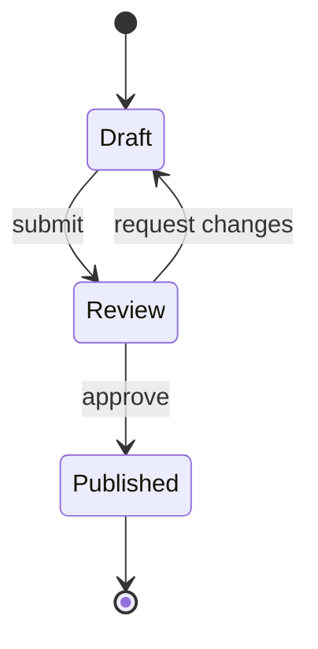

# State diagram

State diagramは、対象が取り得る状態と状態間の遷移を示します。ライフサイクル、状態機械、ワークフローの状態を説明するときに使います。

## 基本構文

- `[*]` は初期または終端の擬似状態です。
- `A --> B: 条件` は状態AからBへの遷移とラベルを表します。
- 状態名は一貫した短い識別子にし、必要なら表示名を分けます。

## 複合状態と分岐

複数の内部状態を持つ場合は複合状態でまとめられます。選択や並行状態の構文は対象Mermaidバージョンに依存することがあるため、必要な場合は公式資料と対象レンダラーで確認します。図が複雑になったら、状態の概要と詳細を別図に分けます。

## 出力前の確認

- 状態名と状態遷移が仕様・実装に一致する。
- 遷移ラベルがイベントや条件を正確に示している。
- 初期・終端状態を誤って通常状態として表していない。
- 無効な遷移や再試行など、読者が理解する必要のある経路を含める。
